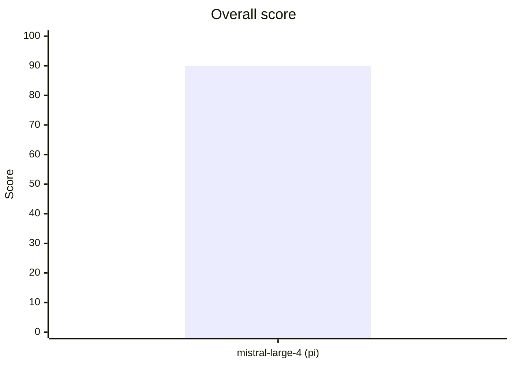

# Model testing

Personal evals for comparing models on the work I actually use AI for: agent work, coding, tech
questions, and shipping a feature across two repos. Every model runs the same tasks and is graded
on the same 0–3 scale.

The harness is a first-class part of a run, not an afterthought. A model in `pi` and the same
model in Claude Code are two different runs, both recorded, because in practice the harness is
half of what you're judging. Rules, scoring and weights are in [FRAMEWORK.md](FRAMEWORK.md).

## Leaderboard

<!-- leaderboard:start -->

| # | Model | Harness | Quant | **Overall** | Agent | Coding | Tech | Build ‡ | Tasks | tok/s |
|---|---|---|---|---|---|---|---|---|---|---|
| 1 | [mistral-large-4](runs/mistral-large-4/pi) | pi |  | **90** | 97 | 89 | 81 | 83 (4/4) | 21/21 | 58 |



‡ Graded and kept, but **not in Overall**: build — the web and backend fixtures evolve, so build scores aren't comparable between runs.

Per-task scores: [results/tasks.csv](results/tasks.csv) · All runs: [results/summary.csv](results/summary.csv) · Why each score: [results/notes.md](results/notes.md)

<!-- leaderboard:end -->

## Requirements

Node 22.18+ and git. **The CLI runs with nothing installed** — Node runs the TypeScript directly
and the framework has no runtime dependencies.

`npm install` is only needed if you want to typecheck it (`npm run typecheck`) or run the smoke
test (`npm run smoke`). The `web/` and `be/` fixtures used by the build tasks do have real
dependencies; `workspace install` handles those inside the sandbox when you need them.

## The CLI

```
node scripts/eval.ts <command>
```

| Command | What it does |
|---|---|
| `harness list` | Every registered harness, what it can do, whether it's installed |
| `harness add <name>` | Scaffold `harnesses/<name>.yaml` for a harness you want to try |
| `mcp config <harness>` | The command that points a harness at the eval MCP server |
| `mcp check` | Prove the eval MCP server works before blaming a model |
| `new-run <model> <harness> [ref]` | Create `runs/<model>/<harness>/` with `meta.yaml` and `scores.csv` |
| `queue <model> [harness]` | Walk the ungraded tasks in order; enter copies the next prompt |
| `go <harness> <model> [task]` | Reset + start in one step, refusing if evidence is unsaved |
| `prompt <task-id>` | Copy one task's prompt to the clipboard, verbatim |
| `workspace reset` | Rebuild the sandbox from `fixtures/`. Run before every task |
| `workspace install` | `npm ci` the sandbox's `web/` and `be/` projects (build tasks only) |
| `start <harness> <model>` | Launch the harness in the sandbox, pinned to that run's model |
| `workspace save <run-dir> <task>` | Record the diff and the MCP calls the model made |
| `summarize` | Rebuild the leaderboard and `results/*.csv` |

Two environment variables matter: `EVAL_WS` (the agent's working directory, default
`~/llm-eval-ws`) and `EVAL_MCP_DIR` (where the eval MCP server gets installed, default
`~/llm-eval-mcp`). Both live outside this repo on purpose, so a model can't read the rubrics.

## Running a model

**1. Make sure the harness is registered.**

```bash
node scripts/eval.ts harness list
```

If the one you want isn't there, scaffold it and fill in the blanks. The entry is what makes the
run reproducible: how it launches, how to read its version, what it can do, and how to attach an
MCP server.

```bash
node scripts/eval.ts harness add my-harness
```

**2. Create the run folder,** then finish `meta.yaml` (quant, host, region, context length,
temperature, tok/s). The harness version is filled in automatically if the harness is installed.

```bash
node scripts/eval.ts new-run mistral-large-4 pi mistral/mistral-large-4-0
```

The third argument is `model_ref`: the id the harness is actually launched with. It's separate
from the folder name because the folder name is for reading and the ref is for the harness, and
they rarely match. You can leave it out and fill it into `meta.yaml` later.

Tasks the harness can't do are written straight into `scores.csv` as `n/a`, so you never have to
remember which ones to skip.

**3. For each task, reset the sandbox and start the harness in it.** One command does both:

```bash
node scripts/eval.ts go pi mistral-large-4 M1
```

That resets the sandbox, installs build dependencies if the task needs them, copies the prompt to
your clipboard, and starts pi pinned to the run's model. **It refuses to reset when the sandbox is
dirty or the MCP call log has entries**, because that means a previous task's evidence hasn't been
saved and resetting would delete it. Save it first, or pass `--force` if there's nothing to keep.

To work through the suite rather than one task, `queue` walks everything still ungraded in a
sensible order, copying each prompt and advancing on enter:

```bash
node scripts/eval.ts queue mistral-large-4
```

It skips anything already carrying a score or `n/a`, so it resumes wherever you stopped. It never
touches the sandbox itself, since a reset would destroy the diff and the call log.

The long way round, if you want the steps separately:

```bash
node scripts/eval.ts workspace reset
node scripts/eval.ts start pi mistral-large-4
```

`start` takes the run, not a model id, and reads `model_ref` from its `meta.yaml`. Every harness
has a default model configured somewhere, and a bare launch quietly uses it, so a harness whose
`launch` contains `{model}` refuses to start without a run. The model you launch and the model
the folder claims can't drift apart.

Paste `tasks/<task>/prompt.md` verbatim, one fresh session per task, and save the reply as
`runs/<model>/<harness>/<task-id>.md`.

- **MCP tasks (M1–M3)** need the server attached first. `node scripts/eval.ts mcp config <harness>`
  prints the exact command for that harness.
- **Build tasks (B1–B4)** need `node scripts/eval.ts workspace install` after the reset.

**4. After any task that touches files or tools,** save the evidence:

```bash
node scripts/eval.ts workspace save runs/qwen3-30b-a3b-q4_k_m/pi A4
```

That writes `A4.diff` (what changed) and, if the model used MCP, `A4.mcp.jsonl` (which tools it
actually called). The MCP log is the only way to grade a task like M3, where the whole question is
whether the model called the destructive tool.

**5. Grade** against `rubric.md` and fill in `scores.csv` with the score and a one-line note. When
the reasoning needs more than a line, which it usually does for the agent and build tasks, put it
in `runs/<model>/<harness>/<task>.grade.md` and keep the CSV note as the summary. `summarize`
collects every note into [results/notes.md](results/notes.md) and links the long form. For close
calls, use the blind-grading prompt in FRAMEWORK.md.

**6. Update the leaderboard.** The GitHub Action does it on push, or locally:

```bash
node scripts/eval.ts summarize
```

## Repo layout

```
harnesses/
  pi.yaml                   how to launch it, what it can do, how to attach MCP
  claude-code.yaml
  opencode.yaml
  aider.yaml
tasks/
  index.csv                 id, category, title, folder, requires
  T1-cors/
    prompt.md               paste this into the harness, verbatim
    rubric.md               answer key + caps (never shown to the model)
fixtures/                   what the sandbox is built from
  inbox/ tickets/           data the agent tasks work on
  calc/ report/             small TypeScript projects with failing tests
  history/                  replayed into real git commits by `workspace reset`
  web/ be/                  a React dashboard and an Express API, for the build tasks
mcp/
  server.ts                 the eval MCP server (a fictional deploy tracker)
  deploys.json              its data, shaped to catch lazy correlation
runs/
  <model>/<harness>/        e.g. runs/qwen3-30b-a3b-q4_k_m/pi/
    meta.yaml               model_ref, quant, host, region, settings, speed
    scores.csv              task, score (0-3 or n/a), notes
    T1.md ...               the model's answer per task
    A4.diff                 what it changed
    M3.mcp.jsonl            which MCP tools it called
    A1.thinking.md          its reasoning, kept but never scored
    A1.grade.md             why it got the score it got
results/
  summary.csv               one row per run (generated)
  tasks.csv                 task x run matrix (generated)
  notes.md                  why each score, with links to the long form (generated)
scripts/
  eval.ts                   the CLI
  commands/ lib/
```

## Naming

Model folders use `<model>-<size>-<quant>` in lowercase, for example `gemma3-27b-q4_k_m` or
`gpt-oss-20b-mxfp4`. Different quants are different runs. The harness folder is the harness name,
and has to match a file in `harnesses/`. To re-run a model, delete the folder and start again; git
history keeps the old run.

## Where models may run

Locally, on my own server, or with EU/US providers. Never on Chinese labs' own APIs, and always
with pinned providers on OpenRouter. Details in
[FRAMEWORK.md](FRAMEWORK.md#where-models-may-run).
